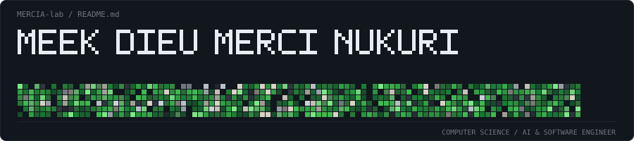
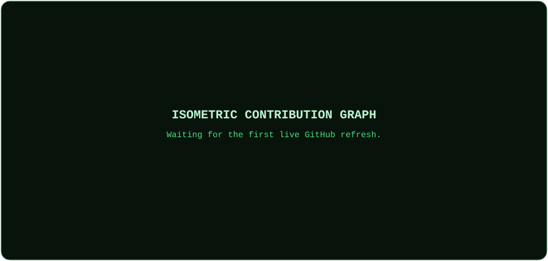
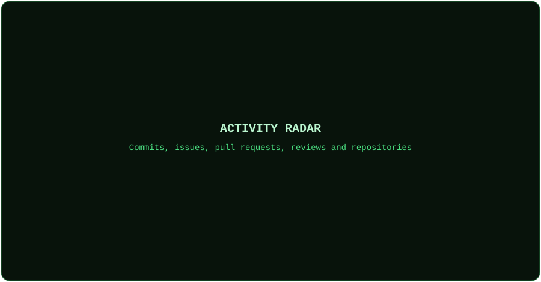
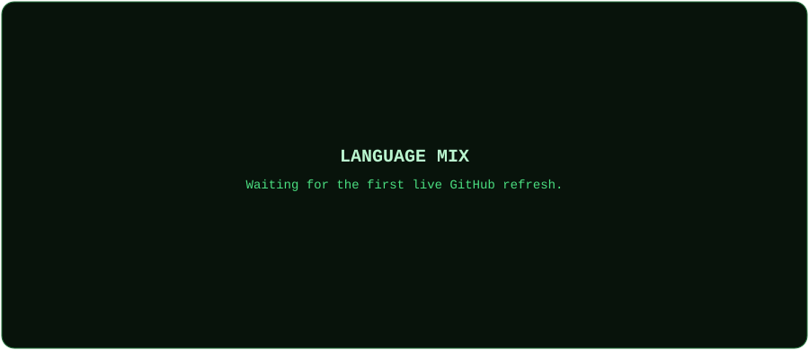
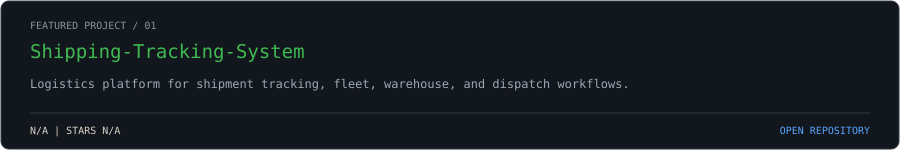

  
  
  

## Who I Am

I'm **Meek Dieu Merci NUKURI**, a computer science student interested in applied AI, machine learning, backend systems, and full-stack software. I enjoy turning ideas into useful projects and learning by building.

## What I Do

- Build full-stack applications and backend services.
- Explore AI and machine-learning tools through practical projects.
- Design project workflows around clear interfaces, useful data, and maintainable code.
- Keep improving through open-source work and continuous learning.

## Vision

I want to build dependable, intelligent software that solves real problems and can grow with the people who use it.

## Beyond Code

Curiosity and creative thinking shape how I approach engineering. I value learning from different fields, asking better questions, and making technology useful to people.

## GitHub Data

These self-hosted diagrams are generated from public GitHub activity and repository data. The profile repository refreshes when its files change, runs a daily refresh to pick up updates to other public repositories, and can be refreshed manually from [GitHub Actions](https://github.com/MERCIA-lab/MERCIA-lab/actions/workflows/update-profile.yml).

  
  
  
  

## Skill Set

**Web & Application Development**

**Languages, Data & Machine Learning**

**Databases, Cloud & Tools**

## Projects

The portfolio diagram is built from repository metadata, not a hand-maintained snapshot. It shows the latest public project descriptions, primary languages, star and fork counts, and update dates. Use the selected repository links below to open the projects.

  

### Selected repositories

- [Shipping Tracking System](https://github.com/MERCIA-lab/Shipping-Tracking-System) — logistics and shipment management.
- [FreeMCue](https://github.com/MERCIA-lab/FreeMCue) — AI meeting assistant and teleprompter.
- [Financial Advisor System](https://github.com/MERCIA-lab/Financial-Advisor-System) — financial planning and analytics.
- [Daily Routine Tracker](https://github.com/MERCIA-lab/daily-routine-tracker) — routines and productivity tracking.

## Achievements

  Building thoughtful software, one project and one lesson at a time.

